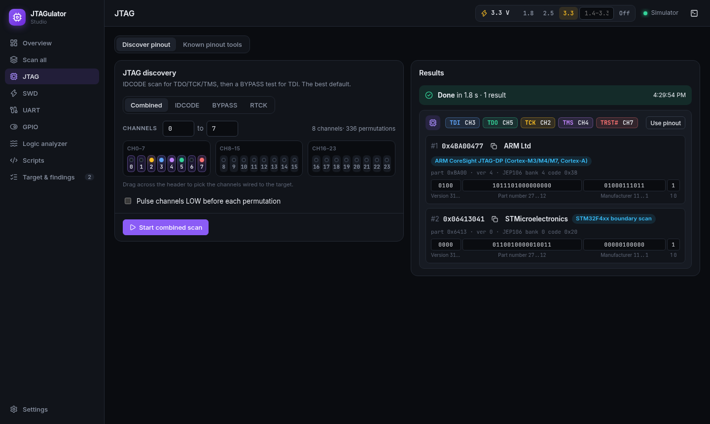
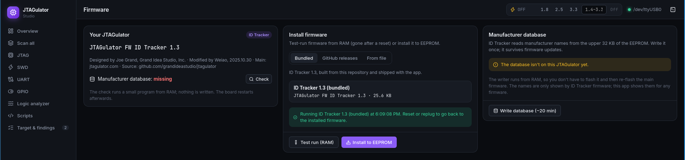
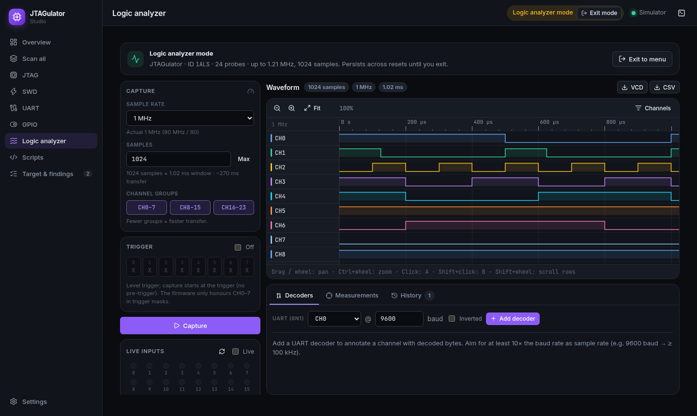

# JTAGulator ID Tracker

Enhanced firmware for the [JTAGulator](https://github.com/grandideastudio/jtagulator), with a 1,953-entry chip manufacturer database, plus **JTAGulator Studio**, a desktop and browser app that drives it.

*Hardware security testing · JTAG/SWD/UART interface discovery · Chip manufacturer identification*

For step-by-step use of every command, wiring and troubleshooting, see the **[user manual](manual.md)**.

---

## Contents

- [Overview](#overview)
- [Firmware features](#firmware-features)
- [JTAGulator Studio](#jtagulator-studio)
- [Installing the firmware](#installing-the-firmware)
- [Manufacturer database](#manufacturer-database)
- [Hardware](#hardware)
- [Development](#development)
- [Use cases](#use-cases)
- [Contributing](#contributing)
- [Notes and warnings](#notes-and-warnings)
- [License](#license)

---

## Overview

The JTAGulator, designed by Joe Grand ([@joegrand](https://github.com/joegrand)), finds on-chip debug interfaces (JTAG, SWD, UART) on embedded devices. It uses a Parallax Propeller P8X32A and a 64 KB EEPROM.

This project adds:

1. **ID Tracker firmware.** The stock firmware uses only the lower 32 KB of the EEPROM. ID Tracker stores a JEP106 manufacturer table in the upper 32 KB, so JTAG and SWD scans show who made each chip. It also fixes and extends the logic analyzer.
2. **JTAGulator Studio** (`studio/`). A graphical frontend for both the stock and the ID Tracker firmware. It runs every scan, decodes results, scripts, captures logic, and installs firmware.

---

## Firmware features

| | Stock JTAGulator 1.12 | ID Tracker 1.3 |
| :--- | :--- | :--- |
| EEPROM used | 32 KB of 64 KB | 64 KB of 64 KB |
| Manufacturer names in JTAG/SWD results | No | Yes, 1,953 manufacturers |
| Logic analyzer trigger channels | CH0–7 (parsing bug) | All 24 |
| Logic analyzer pre-trigger capture | No | Yes |
| All original features | Yes | Yes |

What changed in 1.3 (details in [CHANGES.markdown](CHANGES.markdown)):

- **JTAG manufacturer lookup fixed.** Earlier releases used the raw 11-bit manufacturer field as the table index, so every manufacturer outside JEP106 bank 0 showed the wrong name. For example, ARM (`0x43B`) read entry 571 instead of 563. JTAG now uses `bank × 126 + code`, like SWD.
- **Logic analyzer triggers on all 24 channels.** The trigger mask and value parser kept only the first byte.
- **Pre-trigger capture.** The logic analyzer can keep samples from before the trigger, as OLS and sigrok clients request. In this mode the rate is limited to 909 kHz.

---

## JTAGulator Studio

<div align="center">

<p><em>A JTAG scan: pinout, TRST#, and each IDCODE decoded with its manufacturer</em></p>
</div>

Studio talks to the JTAGulator's own serial menu. It answers every prompt from your form inputs and shows results as structured cards instead of terminal text.

| Area | What you get |
| :--- | :--- |
| **JTAG** | Combined, IDCODE, BYPASS (with known pins) and RTCK scans, device IDs, BYPASS test, IR/DR discovery, EXTEST pin mapper, and an OpenOCD launcher. Load a chip's BSDL file to get instruction names, the EXTEST opcode and package pin names for pin-mapper results |
| **SWD** | Pinout scan, DPIDR read and decode |
| **UART** | Active scan, passive TXD scan with baud measurement, and a terminal to the target console |
| **GPIO** | Read, live monitor with change log, drive outputs |
| **Logic analyzer** | 24-channel waveform viewer, triggers, pre-trigger capture (1.3), UART/SPI/I2C decoders, markers, VCD/CSV export |
| **Firmware** | Shows the installed version, test-runs firmware from RAM, installs firmware to EEPROM, checks GitHub releases for updates, and checks for or writes the manufacturer database |
| **Scan all** | Any combination of scans, run one after another |
| **Chip IDs** | IDCODE and DPIDR decoded in the app against the JEP106 table and about 500 known part numbers, on any firmware |
| **Targets** | Saved targets with known pins, channel labels and findings; export as JSON or a Markdown report |
| **Scripts** | Sandboxed JavaScript using the same functions as the UI, including `uart.expect()`, plus a macro recorder |
| **Simulator** | A software JTAGulator with a fake target board, for trying everything without hardware |
| **Layout** | Works in a desktop window and on a phone-sized screen |

<div align="center">

<p><em>The firmware page, connected to a real JTAGulator</em></p>
</div>

<div align="center">

<p><em>Logic analyzer capture</em></p>
</div>

A script that finds JTAG and reads every IDCODE:

```js
await device.setVoltage(3.3);
const scan = await jtag.scan({ start: 0, end: 7 });
const p = scan.findings[0];
const ids = await jtag.deviceIds({ tdo: p.tdo, tck: p.tck, tms: p.tms });
for (const d of ids.devices) log(d.idcode.hex, d.idcode.manufacturer);
```

### Running Studio

Pushing a `studio-v*` tag makes CI build installers for Windows, macOS and Linux and attach them to a draft release. To run from source you need [Node.js](https://nodejs.org) 20+ and [pnpm](https://pnpm.io). The desktop app also needs [Rust](https://rustup.rs) and the [Tauri prerequisites](https://tauri.app/start/prerequisites/) (on Linux, `webkit2gtk-4.1`).

```sh
cd studio
pnpm install
pnpm tauri dev      # desktop app
pnpm dev            # browser at http://localhost:1420
```

- **Linux permissions.** Serial ports usually belong to a group (`uucp` on Arch, `dialout` on Debian/Ubuntu). Add yourself, then log in again: `sudo usermod -aG uucp $USER`.
- **Browser.** Use Chrome or Edge to reach a real JTAGulator (Web Serial, served from `localhost` or HTTPS). Other browsers can only run the simulator.
- **Remote machine.** If the dev server runs elsewhere, tunnel it with `ssh -L 1420:localhost:1420 <user>@<host>` and open `http://localhost:1420`.
- **Connecting.** Pick the serial port (FTDI ports are marked ★), click **Connect**, then set the target voltage in the top bar.

More detail is in [studio/README.md](studio/README.md).

---

## Installing the firmware

### With JTAGulator Studio (recommended)

1. Connect the JTAGulator and open the **Firmware** page.
2. Click **Check** to see whether the manufacturer database is present. This runs a small program from RAM and writes nothing.
3. If the database is missing, click **Write database** (about 20 minutes). The writer runs from RAM and only touches the upper 32 KB, so the installed firmware stays.
4. Under **Install firmware**, choose the bundled ID Tracker build, a GitHub release, or a file.
   - **Test run (RAM)** tries it until the next reset or power cycle.
   - **Install to EEPROM** makes it permanent.

The database survives firmware updates; you only write it once.

### With Propeller Tool

Use **Propeller Tool 1.3.2** (or OpenSpin plus a Propeller loader).

1. **Database (once).** Open `eepromupdate/EEPROM_Update.spin` and load it into RAM (F10) or EEPROM (F11). Watch a serial terminal at 115200 8N1. It takes about 20 minutes and ends with `Result: Success - Writing completion flag`. If it's interrupted, power-cycle and run it again.
2. **Firmware.** Open `JTAGulator.spin` from the repository root and load it into EEPROM (F11).

<div align="center">

<p><em>Database write in progress (serial terminal)</em></p>
</div>

### Serial settings

115200 baud, 8 data bits, 1 stop bit, no parity, no flow control.

---

## Manufacturer database

The table follows the JEDEC **JEP106** list, the same list used by the manufacturer field of a JTAG IDCODE and the designer field of an ARM DPIDR. That field holds a bank number (bits 11..8) and a 7-bit code (bits 7..1).

- **Layout.** 126 entries per bank, 16 bytes per name, starting at EEPROM address `0x8080`. A completion flag (`0x5A`) sits at `0xFFF0`.
- **Size.** 1,953 manufacturers, covering major vendors (Intel, ARM, ST, NXP, TI), many Asian manufacturers, and FPGA, MCU and specialized IC makers.
- **App copy.** Studio carries the same table (`studio/src/lib/data/jep106.json`, generated from `eepromupdate/jep106.inc`), so names appear even on stock firmware.

<div align="center">

<p><em>ID Tracker in a plain serial terminal: the manufacturer name is printed with each JTAG ID</em></p>
</div>

---

## Hardware

**You need:**

- A JTAGulator
- A Mini USB cable
- Jumper wires to the target

**Targets:**

- Devices with JTAG, SWD or UART
- I/O levels from 1.4 V to 3.3 V
- UARTs at standard baud rates

---

## Development

| Path | Contents |
| :--- | :--- |
| `JTAGulator.spin`, `Prop*.spin`, … | Firmware (Spin and PASM) |
| `eepromupdate/` | Manufacturer database writer and the JEP106 table |
| `studio/` | JTAGulator Studio (Tauri v2, Svelte 5, TypeScript) |
| `studio/hw/` | Tests against a real JTAGulator |
| `.github/workflows/` | CI, Studio installers (`studio-v*` tags), firmware releases (`fw-v*` tags) |

- **Build the firmware** with [OpenSpin](https://github.com/parallaxinc/OpenSpin): `openspin -b JTAGulator.spin`. Then run `studio/scripts/build-firmware.sh` to refresh the images bundled with Studio.
- **Simulator tests:** `cd studio && pnpm test`.
- **Hardware tests:** `npx vitest run --config hw/vitest.config.ts`, with a JTAGulator on `/dev/ttyUSB0` (set `JTAGULATOR_PORT` for another port). Nothing needs to be wired to the channels, and the installed firmware is never changed: firmware under test is loaded into RAM.

---

## Use cases

- **Hardware security assessment.** Find exposed debug interfaces and test points.
- **Reverse engineering.** Identify chip manufacturers, likely parts and debug access.
- **Repair.** Recover bricked devices and reach programming interfaces.
- **Learning.** JTAG, SWD and boundary scan in practice.

---

## Contributing

Issues and pull requests are welcome.

To add a missing manufacturer, send:

- the chip's IDCODE value
- the manufacturer's official name
- a source (datasheet or website)

After editing `eepromupdate/jep106.inc`, run `pnpm gen:jep106` in `studio/` to refresh the app's copy.

To add a known part number (so Studio names the exact chip, not just its manufacturer), add an entry to `studio/src/lib/data/parts-extra.json` with a source link, then run `pnpm gen:parts --urjtag <UrJTAG checkout> --openocd <OpenOCD checkout>` in `studio/`. Entries look like:

```json
{ "id": "0x0362D093", "mask": "0x0FFFFFFF", "name": "XC7A35T", "vendor": "Xilinx (AMD)", "family": "Artix-7",
  "kind": "jtag", "source": "https://link-to-datasheet-or-bsdl" }
```

`mask` 0x0FFFFFFF ignores the version nibble; `kind` is `jtag`, `swd` or `any`. The rest of the table is imported from [openFPGALoader](https://github.com/trabucayre/openFPGALoader), [UrJTAG](https://sourceforge.net/p/urjtag/git/ci/master/tree/urjtag/data/) and [OpenOCD](https://github.com/openocd-org/openocd/tree/master/tcl/target).

---

## Notes and warnings

**Legal and ethical use:**

- **Authorized testing only.** Make sure you have permission to test the device.
- **Local law.** Rules on hardware debugging differ between countries.
- **Intellectual property.** Don't use this tool for piracy or infringement.

**Technical precautions:**

1. **Ground first,** then signals. Double-check wiring to avoid shorts.
2. **Match the voltage.** Set the target I/O voltage to the target's logic level. Never connect VADJ to the target.
3. **ESD.** Use ESD protection with sensitive devices.
4. **Persistent modes.** Logic analyzer and OpenOCD mode stay on through resets and power cycles until you exit them (Ctrl-X, or **Exit mode** in Studio).

**FAQ:**

- **Why does writing the database take 20 minutes?** EEPROM writes are slow, and every page is verified.
- **Can more manufacturers be added?** Yes, there is room for one or two hundred more.
- **Do I need ID Tracker to use Studio?** No. Studio works with the stock firmware and decodes manufacturer names itself.
- **Can installing firmware brick the JTAGulator?** No. The Propeller boots from ROM and can always be reloaded over USB. Use **Test run (RAM)** first if you're unsure about an image.

---

## License

[](https://opensource.org/licenses/MIT)

The original JTAGulator firmware is distributed under the Creative Commons Attribution 3.0 United States license.

**Thanks to:**

- Joe Grand, for creating the JTAGulator
- Chip manufacturers, for publishing their technical documentation
- Everyone who tested and gave feedback
